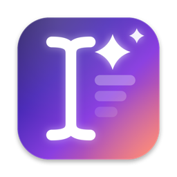
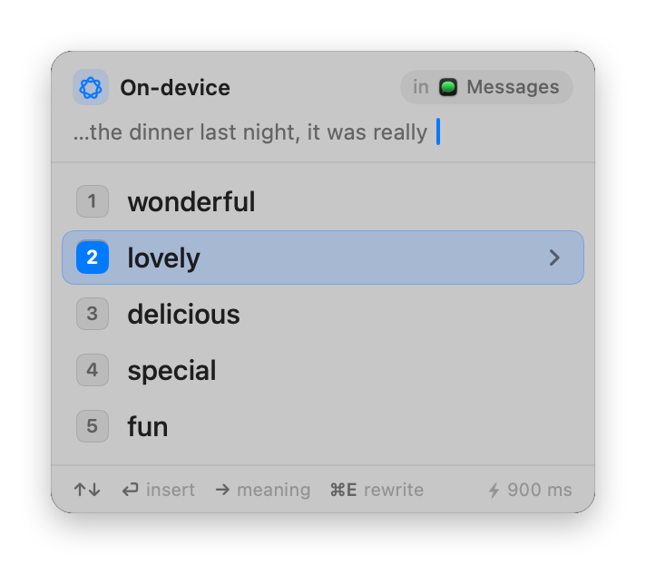

<p align="center">
  
</p>

<h1 align="center">NextWord</h1>

<p align="center">
  <b>Find the right word, in any app.</b><br>
  A macOS menu bar app that suggests the next word and rewrites your text, where you type.
</p>

<p align="center">
  <a href="https://github.com/nandzz/next-word/releases/latest"></a>
  
  
  <a href="https://github.com/nandzz/homebrew-tap"></a>
  
  <a href="LICENSE"></a>
</p>

<p align="center">
  <picture>
    <source media="(prefers-color-scheme: dark)" srcset="docs/panel-words-dark.png">
    
  </picture>
</p>

---

## ✨ How it works

1. **Type** in any app: Messages, Slack, WhatsApp, Mail, Notes and more.
2. **Hold ⇧ ?** when you need a word. A panel opens near the cursor.
3. **Push 1–9** or **⏎**. NextWord types the word for you.

If the cursor is in the middle of a word, NextWord completes that word.

## 🧠 Features

### Words that fit your sentence

NextWord reads the text near the cursor and shows 5, 10 or 20 words that fit the grammar, the tone and the language of your text.

### Meaning, in your language


Not sure about a word? Push **→** to see its meaning, the part of speech and an example, in the language of your text.

Push **→** again to see the translation and the meaning in your own language.

<br clear="right">

### Rewrite the full message


Push **⌘E** in the panel to get 3 versions of your text:

- **Clearer**: correct grammar and spelling, the same length.
- **Shorter**: the same message, more direct.
- **Reworded**: different words, in your tone.

Select one, and NextWord replaces the text. If text is selected, NextWord rewrites only the selection. Push **⌘Z** in the app to undo.

<br clear="right">

### Three engines

| Engine | Speed | Your text | You need |
|---|---|---|---|
| 🍏 **On-device** | approximately 1 s | stays on your Mac | macOS 26, Apple silicon, Apple Intelligence |
| ✳️ **Claude** | approximately 4–6 s | goes to Anthropic | the [Claude Code CLI](https://docs.anthropic.com/en/docs/claude-code), logged in |
| ⌨️ **Codex** | a few seconds | goes to OpenAI | the Codex CLI, logged in |

With Claude you can select Haiku, Sonnet, Opus, Fable or a custom model. You do not need an API key.

You can also set the number of words, the tone, the language, the long-press duration and the meaning view in **Settings**.

## 📦 Install

**With Homebrew**

```bash
brew tap nandzz/tap
brew trust --cask nandzz/tap/nextword
brew install --cask nandzz/tap/nextword
```

**Or download it**

1. Download `NextWord-<version>.zip` from [Releases](https://github.com/nandzz/next-word/releases/latest).
2. Open the zip file and move `NextWord.app` to the **Applications** folder.
3. Open NextWord and give it **Accessibility** access (see [Permissions](#-permissions)).

The app is signed with a Developer ID certificate and notarized by Apple.

### Requirements

- macOS 14 or later. The on-device engine needs macOS 26, a Mac with Apple silicon and Apple Intelligence turned on.
- For the Claude engine: the [Claude Code CLI](https://docs.anthropic.com/en/docs/claude-code), logged in.
- For the Codex engine: the Codex CLI (`npm i -g @openai/codex`), logged in with `codex login`.

## ⌨️ Keys in the panel

| Key | Action |
|---|---|
| <kbd>↑</kbd> <kbd>↓</kbd> or <kbd>Tab</kbd> | Select the previous or next word |
| <kbd>⏎</kbd> or <kbd>1</kbd>–<kbd>9</kbd>, <kbd>0</kbd> | Type the selected word, or word 1–10 |
| <kbd>→</kbd> | Show the meaning. Push again to show it in your language |
| <kbd>←</kbd> | Go back |
| <kbd>⌘</kbd> <kbd>E</kbd> | Show rewrites of the text. Push again to go back |
| <kbd>⌘</kbd> <kbd>R</kbd> | Get new suggestions or rewrites |
| <kbd>Esc</kbd> | Close the panel |

In the rewrite view, <kbd>↑</kbd> <kbd>↓</kbd> select a rewrite, and <kbd>⏎</kbd> or <kbd>1</kbd>–<kbd>3</kbd> replace the text with it.

## 🔐 Permissions

NextWord needs **Accessibility** access. Give it in **System Settings → Privacy & Security → Accessibility**. NextWord uses this access to:

- detect the long press of the "?" key,
- read the text near the cursor,
- type the word that you select,
- replace the text with the rewrite that you select.

If NextWord cannot read a text field, it can copy the current line: it selects to the start of the line, copies the text, and then restores your clipboard. NextWord does not do this in password fields, terminals, code editors or Finder.

To replace text with a rewrite, NextWord pastes it: it puts the rewrite on the clipboard, selects the text if necessary, pushes ⌘V, and then restores your clipboard. In Mail, Outlook, terminals and code editors, NextWord rewrites only selected text. It does not rewrite password fields or texts longer than 2,000 characters.

## 🛡️ Privacy

- With the on-device engine, the text stays on your Mac.
- With Claude or Codex, NextWord gives the text near the cursor (approximately 1,500 characters) to that CLI. The CLI sends it to Anthropic or OpenAI with your account.
- When you push ⌘E, NextWord also gives the full text that it rewrites (at most 2,000 characters) to that CLI.
- "Fall back to Claude" is off by default. If you turn it on, NextWord uses Claude when the selected engine is not available. The panel then shows "fallback".
- NextWord does not keep your text. Release builds write no log files.

## 🛠️ For developers

### Build

```bash
./Scripts/build-app.sh --install --run
```

This builds the app, signs it with your Apple Development certificate, copies it to `~/Applications` and starts it.

To make a build that you can give to other people:

```bash
NOTARY_PROFILE=<notarytool-profile> ./Scripts/build-app.sh --dist
```

This builds a universal binary, signs it with your Developer ID Application certificate and a secure timestamp, notarizes it, and makes `build/NextWord.zip`. To make the keychain profile, use `xcrun notarytool store-credentials`.

### Tests

```bash
xcrun swift test
```

### Project layout

| Folder | Contents |
|---|---|
| `Sources/NextWord/App` | App entry point and coordinator |
| `Sources/NextWord/Core` | Models, settings, panel logic, rewrite planning |
| `Sources/NextWord/Input` | Key detection, text reading, text insertion and replacement |
| `Sources/NextWord/Claude`, `Codex`, `OnDevice`, `Engines` | The engines |
| `Sources/NextWord/UI` | Panel, menu bar popover, settings window |
| `Tests/NextWordTests` | Unit tests |

## 📄 License

NextWord uses the MIT License. See [LICENSE](LICENSE).
